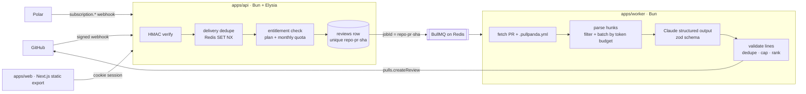
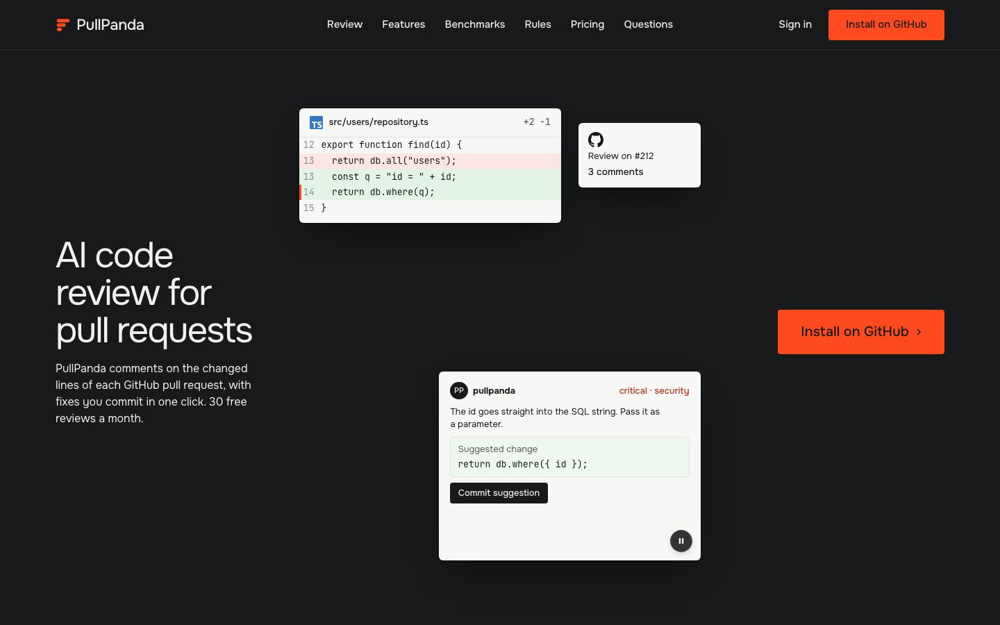
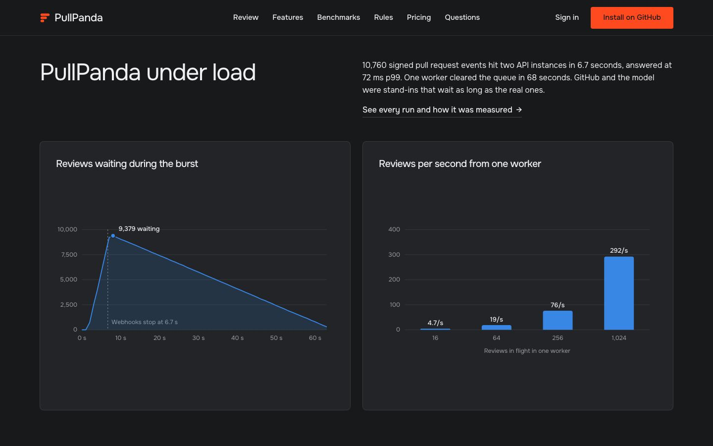

# PullPanda

AI code review as a GitHub App. When a pull request is opened or pushed to, PullPanda reads the diff, asks an
Claude (Opus 5.5 by default; OpenAI is a configurable alternative) for a structured review, validates every finding against the diff, and posts **one GitHub review
with inline comments and one-click suggested fixes**. Pro is sold per repository through Polar.





## Load test results



Measured on an Apple M4 laptop (10 cores) with Postgres 17 and Redis 7 in Docker on the same machine as the API, the
worker and the load generator. GitHub and the model are stand-ins that wait for realistic times (GitHub calls 60 to
250 ms, the model a log-normal around 2.5 s per batch). Everything else is the production path. Full tables are
on the site's `/benchmarks/` page.

| Scenario | Result |
| --- | --- |
| Burst: 10,760 signed PR events at 2 API instances | 1,803 req/s for 6.7 s, p99 72 ms, all 1,240 redeliveries answered as duplicates |
| Same burst, drained by one worker (512 in flight) | peak queue 9,379, cleared in 68 s (147 reviews/s), webhook-to-review p95 58 s |
| One worker, 1,024 reviews in flight | 292 reviews/s (~1M an hour); per-review time flat at ~3.0 s, i.e. the stand-ins' latency |
| One API instance, pool 10 → pool 30 | 1,616 → 2,237 req/s at 128 concurrent; then the single Bun process is the limit |

**What the load test caught and fixed** (each with a regression test):

- **Quota race.** 400 concurrent events for one installation queued 38 reviews against a 30-review quota. The
  check-then-insert now runs in one transaction under `pg_advisory_xact_lock` on the quota's scope. After the fix:
  exactly 30. This costs about 17% of peak intake, a fair trade for correct billing.
- **Suspended installations woke up.** Every PR event re-saved its installation with `suspended = false`. Upserts
  now set only the fields they know, and only when the value changed (`ON CONFLICT ... WHERE ... IS DISTINCT FROM`).
- **A crash only on a live server.** An Elysia params schema threw on Bun's native router while `app.handle` tests
  passed. A test now boots a listening server.
- **The worker's rate limit was hard-coded at 30/min.** It is now `WORKER_RATE_PER_MIN`.

Reproduce:

```bash
./bench/api-cluster.sh 2 20 &                                  # 2 API instances, 20 DB connections each
bun bench/intake.ts --total=40000 --concurrency=256 --api=http://localhost:3101,http://localhost:3102
. bench/env.sh && bun bench/worker.ts --concurrency=256 --jobs=6000
bun bench/report.ts                                            # refresh the site's charts
```

## Repository layout

| Path | What it is |
| --- | --- |
| `apps/api` | Elysia HTTP API: GitHub + Polar webhooks, GitHub OAuth login, dashboard + billing endpoints, OpenAPI at `/docs` |
| `apps/worker` | BullMQ worker that runs reviews, with retries, a dead-letter set and graceful drain |
| `apps/web` | Next.js static export: the marketing page (built with the taste design kit) and the React dashboard |
| `packages/core` | Pure review pipeline: diff parser, batching, Claude and OpenAI review models, GitHub client, plans, HMAC |
| `packages/db` | Drizzle schema, migrations and client for Postgres |
| `bench` | Load generators for webhook intake and worker drain, and the report that feeds the site's charts |

## Engineering decisions

- **Webhooks are verified and idempotent.** `X-Hub-Signature-256` is checked with a constant-time HMAC compare.
  Delivery ids are deduped in Redis, and a unique `(repository, pr, head_sha)` index means a redelivered or
  repeated event can never enqueue or post twice. The BullMQ job id is the same key.
- **The API never does slow work.** It records the review, enqueues it and returns `202`. The worker is a separate
  long-running process, because a `while(true)` loop inside a serverless route (the old design) gets frozen.
- **Failures are classified.** 4xx errors from GitHub are `UnrecoverableError`s and go straight to the failed set.
  Everything else retries 4 times with exponential backoff. Failed jobs are kept for 7 days for replay, and the
  final status is written back to Postgres for the dashboard.
- **Stale work is skipped.** The worker re-reads the PR head. If a newer push superseded the commit, it skips
  instead of commenting on outdated code.
- **The model is never trusted blindly.** Reviews use Claude structured outputs (a zod schema), adaptive thinking at
  high effort, and the server-side refusal fallback; a refusal that survives it fails the job without retries. Each finding's
  line must fall inside a diff hunk on the right side, and multi-line ranges must stay within one hunk.
  Hallucinated lines are dropped, which also prevents GitHub `422`s. Findings are deduped, filtered by the
  repo's `minSeverity`, ranked and capped.
- **Large PRs are budgeted.** Lockfiles, build output and binaries are ignored. Diffs are annotated with
  new-file line numbers, truncated per file, then packed into token-bounded batches that are reviewed
  concurrently. Files past the plan's budget are listed as skipped in the summary.
- **Per-repo config.** `.pullpanda.yml` is read at the PR's head commit and validated with zod. Invalid config
  falls back to defaults and is reported in the review.
- **Billing is per repository.** The Polar checkout metadata carries the repository id onto the subscription.
  Webhooks are verified with Standard Webhooks and applied once (`processed_events`). Canceled subscriptions
  keep Pro until the period ends.
- **Everything is injectable.** The HTTP layer takes an `ApiDeps` object and the pipeline takes a `GitHubClient`
  and a `ReviewModel`, so tests swap in fakes without mocking modules.

## Running locally

```bash
bun install
docker compose up -d          # Postgres 17 + Redis 7
cp .env.example .env          # fill in what you have; everything optional boots disabled
bun run db:migrate
bun run dev:api               # http://localhost:3001  (OpenAPI docs at /docs)
bun run dev:worker            # needs ANTHROPIC_API_KEY and the GitHub App credentials
bun run dev:web               # http://localhost:3000
```

To review one real PR without the GitHub App (posts as you; `--plan` and `--dry-run` post nothing):

```bash
GITHUB_TOKEN=$(gh auth token) bun --env-file=.env apps/worker/scripts/review-pr.ts owner/repo#1 --dry-run
```

To try the dashboard without creating a GitHub App, seed demo data and set the printed cookie on `localhost`:

```bash
bun run apps/api/scripts/seed-demo.ts
```

To receive real webhooks locally, point the GitHub App's webhook URL at a tunnel (for example smee.io) that
forwards to `http://localhost:3001/webhooks/github`.

## Tests

```bash
bun test          # 37 tests: unit, API integration on Postgres, live-server, and end-to-end
bun run typecheck
```

- `packages/core/test`: diff parsing, HMAC, batching, config, entitlements and the full review pipeline
  against fake GitHub and fake model.
- `apps/api/test`: every route through `app.handle` against a real Postgres. Covers signature rejection,
  idempotency, quotas, OAuth CSRF state, checkout authorization and the Polar upgrade and downgrade path.
  Also boots a live server for routes that behave differently on Bun's native router.
- `apps/worker/test/e2e.test.ts`: signed webhook → API → real BullMQ queue on Redis → worker → GitHub review.
  Also covers stale-commit skips, permanent failures and no double-posting on retries.

CI (`.github/workflows/ci.yml`) runs migrations, typecheck, tests and the web build against Postgres and Redis
service containers.

## Deploying

`Dockerfile` has two targets: `docker build --target api` (runs migrations, then serves) and `--target worker`.
Any container host works (Railway, Fly, Render). `apps/web` is a static export (`apps/web/out`) for any CDN. Set
`NEXT_PUBLIC_API_URL` and `NEXT_PUBLIC_GITHUB_APP_SLUG` at build time. If web and API are on different sites,
set `COOKIE_SAMESITE=none`.
